<!-- Generated by profile-gen from profile.yaml. Do not edit by hand. -->

<picture><source media="(prefers-color-scheme: dark)" srcset="assets/terminal-dark.svg"></picture>

### See it run

<table>
<tr>
<td width="50%" valign="top"><a href="https://github.com/armaghanrashid/starport">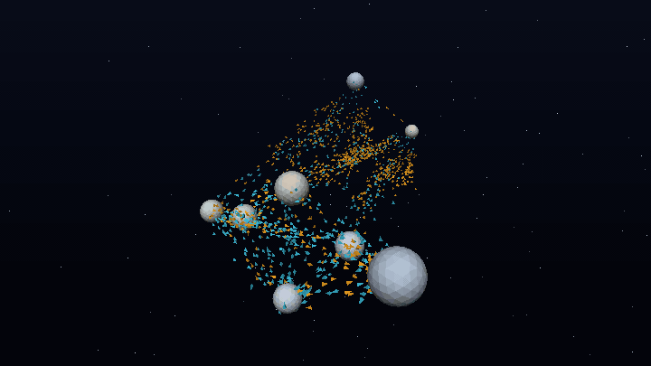</a> <b>starport</b> · haulers trading between station markets</td>
<td width="50%" valign="top"><a href="https://github.com/armaghanrashid/parallax-ball-tracker">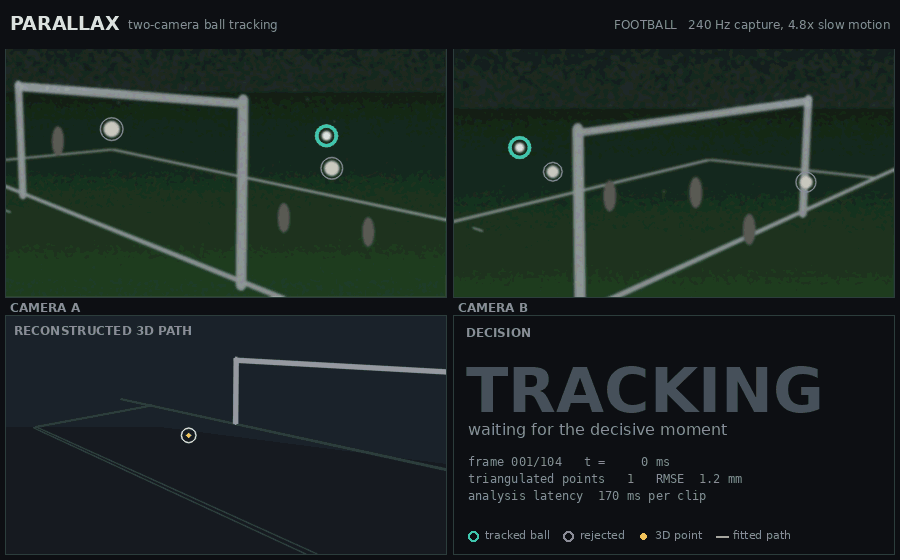</a> <b>parallax-ball-tracker</b> · two-camera tracking and the line call</td>
</tr>
<tr>
<td width="50%" valign="top"><a href="https://github.com/armaghanrashid/enclave-messenger">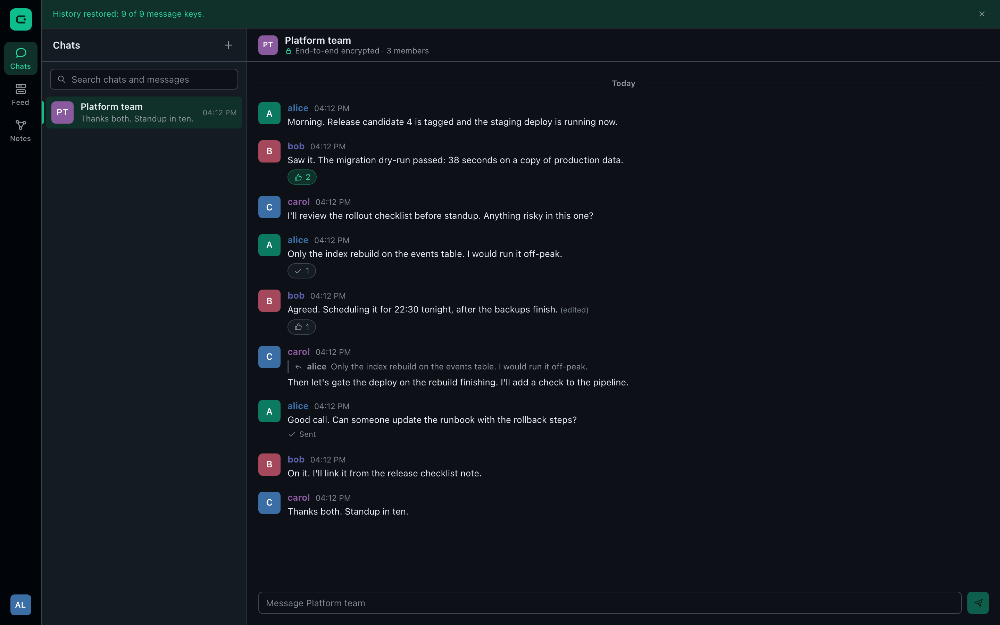</a> <b>enclave-messenger</b> · chat</td>
<td width="50%" valign="top"><a href="https://github.com/armaghanrashid/meridian-trader">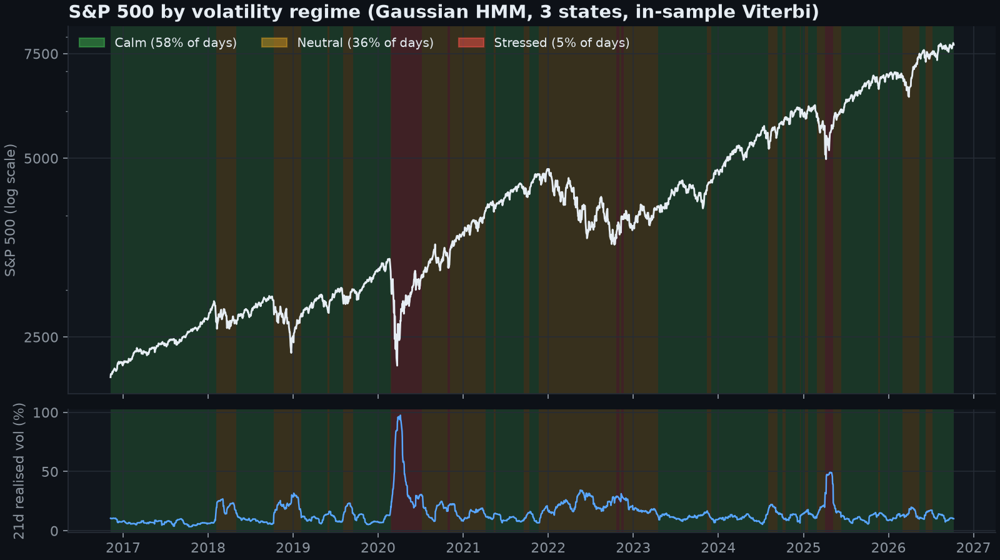</a> <b>meridian-trader</b> · market regimes from a hidden Markov model</td>
</tr>
</table>

### In plain text

I build the data and cloud plumbing that products quietly depend on: ETL pipelines on Databricks, containerised FastAPI services and infrastructure as code. I'm a computer science student at McGill (May 2027) with five internships behind me, across data, cloud, AI and research, and I'm looking for new-grad software, data engineering and AI/ML roles.

### Featured builds

<table>
<tr>
<td width="50%" valign="top"><a href="https://github.com/armaghanrashid/starport"><picture><source media="(prefers-color-scheme: dark)" srcset="assets/card-starport-dark.svg">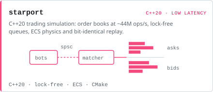</picture></a></td>
<td width="50%" valign="top"><a href="https://github.com/armaghanrashid/enclave-messenger"><picture><source media="(prefers-color-scheme: dark)" srcset="assets/card-enclave-messenger-dark.svg">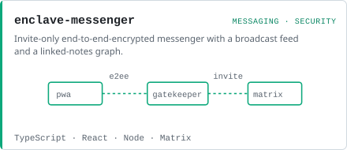</picture></a></td>
</tr>
<tr>
<td width="50%" valign="top"><a href="https://github.com/armaghanrashid/parallax-ball-tracker"><picture><source media="(prefers-color-scheme: dark)" srcset="assets/card-parallax-ball-tracker-dark.svg">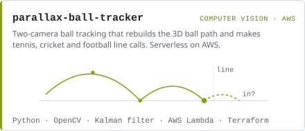</picture></a></td>
<td width="50%" valign="top"><a href="https://github.com/armaghanrashid/meridian-trader"><picture><source media="(prefers-color-scheme: dark)" srcset="assets/card-meridian-trader-dark.svg">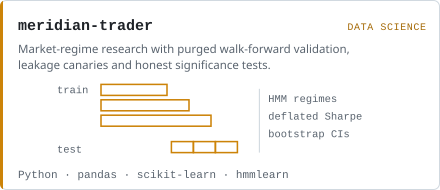</picture></a></td>
</tr>
<tr>
<td width="50%" valign="top"><a href="https://github.com/armaghanrashid/conduit-311-pipeline"><picture><source media="(prefers-color-scheme: dark)" srcset="assets/card-conduit-311-pipeline-dark.svg">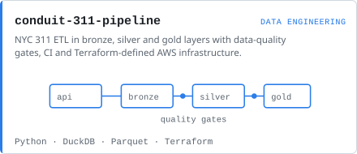</picture></a></td>
<td width="50%" valign="top"><a href="https://github.com/armaghanrashid/quorum-kv"><picture><source media="(prefers-color-scheme: dark)" srcset="assets/card-quorum-kv-dark.svg">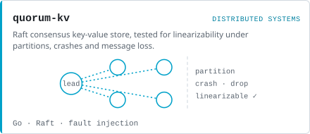</picture></a></td>
</tr>
<tr>
<td width="50%" valign="top"><a href="https://github.com/armaghanrashid/resume-wrecker"><picture><source media="(prefers-color-scheme: dark)" srcset="assets/card-resume-wrecker-dark.svg">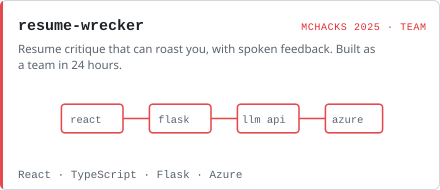</picture></a></td>
</tr>
</table>

**Closed source, in development:** Slate (offline-first personal finance app) · Orca (on-device lecture transcription for macOS)

### Experience

| Role | Where | Impact |
| --- | --- | --- |
| Data &amp; AI Intern 2026 | Visionet | AI pre-sales copilot that drafts proposals and estimates: about 35% less proposal-prep time in pilot use. PySpark ETL on Databricks, Azure and GCP. |
| Cloud &amp; AI Engineering Intern 2024 | Visionet | Re-architected batch workflows into 5+ FastAPI microservices on Azure: **40% lower latency**. Terraform plus GitHub Actions CI/CD. |
| Intern 2023 | UN World Food Programme | Grafana dashboards and Python ETL for programmes serving 5,000+ people; 20% faster reporting. |
| Research Intern 2022–23 | Blekinge Institute of Technology | Video-quality metrics in OpenCV and scikit-image; reproducible experiments with pytest and Docker. |

### Stack

<table>
<tr><td><b>Languages</b></td><td>Python · SQL · C++ · Go · Java · C · TypeScript · OCaml · Bash · R</td></tr>
<tr><td><b>Data &amp; ML</b></td><td>PySpark · Databricks · DuckDB · pandas · NumPy · scikit-learn · OpenCV · hmmlearn</td></tr>
<tr><td><b>Cloud &amp; DevOps</b></td><td>AWS · Azure · GCP · Docker · Terraform · GitHub Actions · Linux</td></tr>
<tr><td><b>Backend</b></td><td>FastAPI · Flask · Node · React · REST · MySQL · pytest · JUnit</td></tr>
</table>

This page is generated by profile-gen from profile.yaml and rebuilt nightly by GitHub Actions. · <a href="https://www.linkedin.com/in/muhammad-armaghan-rashid">LinkedIn</a>
